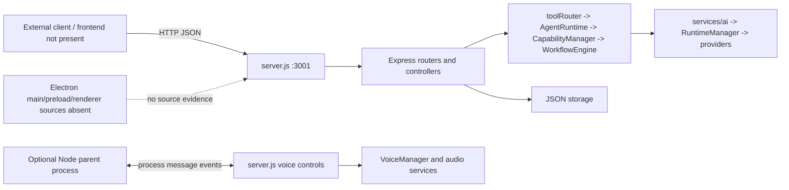

# API and desktop integration

## Express server

`server.js` imports dotenv, creates Express, mounts feature routes, and listens on `127.0.0.1:3001`. A global guard rejects non-loopback peers and browser origins outside localhost/127.0.0.1/::1 or the exact comma-separated origins in `SAMGPT_ALLOWED_ORIGINS`. Requests without an `Origin` header are allowed only from a loopback peer. `Origin: null` is rejected, so a `file://` Electron renderer cannot call this API directly. The server remains unauthenticated; the loopback guard is not suitable for network or multi-user exposure. Multer still uses `uploads/`; request schemas, upload limits, rate limits and graceful shutdown remain separate follow-up work.

## Route inventory

| Prefix/path | Methods | Responsibility |
|---|---|---|
| `/chat`, `/chat/stream`, `/chat/history` | POST, POST, GET | Chat, plain text streaming, chat history |
| `/history` | GET | Compatibility history endpoint |
| `/voice` | POST | Voice interaction |
| `/activities` | GET | Activity list |
| `/memory` | GET, DELETE `/:key` | Memory profile and delete key |
| `/notes` | GET, POST, PUT `/:id`, DELETE `/:id` | Notes CRUD |
| `/tasks` | GET, POST, PUT `/:id`, DELETE `/:id` | Tasks CRUD |
| `/pdf/upload`, `/pdf/list`, `/pdf/ask`, `/pdf/:name`, `/pdf/search`, `/pdf/action` | POST/GET/DELETE | PDF ingestion, retrieval, query, actions |
| `/settings` | GET, POST | Settings read/update |
| `/stats`, `/backup`, `/restore` | GET, GET, POST | Stats, bulk user data export/import |
| `/confirm`, `/cancel`, `/pending` | POST, POST, GET | Generic pending actions |
| `/gmail/status`, `/gmail/auth`, `/gmail/callback` | GET | Gmail OAuth lifecycle/status |
| `/google/auth`, `/google/callback`, `/calendar/status` | GET | Shared Google OAuth and calendar status |
| `/email/provide-input` | POST | Continue a waiting email draft and obtain send confirmation |
| `/models`, `/models/health`, `/models/test/:key`, `/models/capabilities` | GET, GET, POST, GET | Model catalog/health/test/capability routes |
| `/audio/devices` | GET | Audio device listing |
| `/desktop/history`, `/desktop/system-status`, `/desktop/screenshot/:filename` | GET | Desktop history, system snapshot, validated screenshot serving |

Nested route modules are the source of truth; see `features/*/*Routes.js` and `server.js` for exact controller behavior. The chat route/controller contract has mocked loopback integration coverage; other routes have not been exercised end-to-end. Model health and model-test routes can make provider network calls. `POST /models/test/:key` sends an external test prompt to the configured model.

## Request/response and streaming contracts

`POST /chat` expects a non-empty string `{message}` and returns `{reply}`; missing, non-string, or blank messages receive HTTP 400 `{error:"message is required"}`. Chat requests receive or generate an `X-Request-Id` response header before local-origin checks, so rejected requests can be correlated too. The ID is not an authorization credential. Application/provider errors handled by the chat service retain the `{reply}` shape with safe text; controller-level failures retain the existing generic 500 `{error}` body. `/chat/stream` is chunked `text/plain`, not SSE. It writes marker lines (`__TIMELINE__:`, `__CONFIRMATION__:`, `__WAITING_INPUT__:`) mixed with plain response text. Clients must parse that custom protocol. `POST /email/provide-input` uses the same text/plain confirmation marker. `/confirm`, CRUD routes and status routes use different JSON shapes; there is no shared API error schema.

## Electron, frontend and IPC

No React renderer, Electron `BrowserWindow`, `contextBridge`, preload script, `ipcMain`, or `ipcRenderer` source was found in this repository. `main.js` is a terminal/readline application. `server.js` listens for Node `process.on("message")` and handles voice commands including `START_VOICE_MODE`, `STOP_VOICE_MODE`, `TOGGLE_VOICE_MODE`, `START_LISTENING`, `CANCEL_LISTENING`, `STOP_SPEAKING`, `PAUSE_SPEAKING`, `RESUME_SPEAKING`, and `RELOAD_VOICE_SETTINGS`; logs now include message type only. `VoiceEventEmitter` and `VoiceManager` provide voice events internally, but no Electron bridge endpoint was found. Therefore the real client origin and frontend/backend contract cannot be verified here. A future Electron client using `file://` needs a local authenticated bridge or another explicitly designed origin; adding `null` to allowed origins is not supported.

## Persistence and settings

`storage/storagePath.js` creates `~/.personal-agent/` and supplies paths. Core JSON persistence now uses `storage/jsonFile.js` for atomic replacement, shape checks and process-local locking. PDF upload files are staged in current-working-directory-relative `uploads/`; there is no database engine or schema migration system. Locks do not coordinate separate server processes.

`/backup` exports tasks, notes, semantic memory, history, settings and stats. It excludes pending actions, Google tokens, projects/preferences and PDF data/files, among other stores. `/restore` validates the full supported backup shape and size/depth before writes; it applies files sequentially and attempts reverse-order rollback on failure, so multi-file restore remains best-effort rather than crash-atomic. Backups contain personal content. See [storage and recovery](SAMGPT_STORAGE_AND_RECOVERY.md) for the verified inventory and limits.

See [security audit](SAMGPT_SECURITY_AND_RELIABILITY_AUDIT.md).
