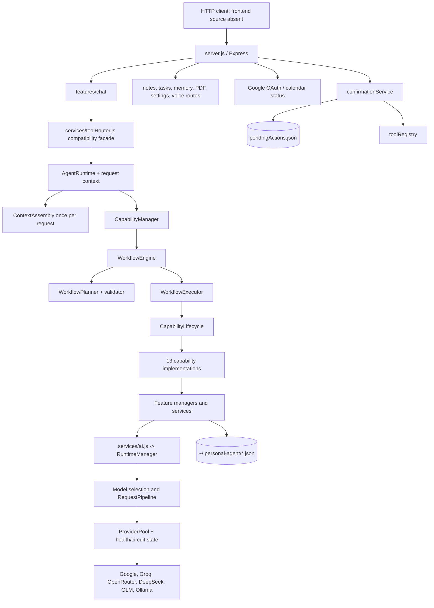
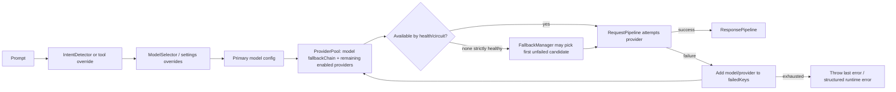

# samGPT backend architecture

This describes the checked-out source tree after Phase 3 route integration coverage on 2026-10-18. It includes the canonical request and streaming paths used by chat; legacy CIE entry points remain for specialized callers.

## System components

## Runtime/provider registry and routing

`core/runtime/ProviderPool.js` registers built-in provider implementations and tracks capability metadata, health, latency, circuit state and candidate scoring. Providers are Google Gemini, Groq, DeepSeek, GLM, OpenRouter and Ollama. `core/registry/ModelRegistry.js` defines model IDs, enablement, capabilities and per-model fallback chains. `services/modelSelection/` chooses a primary model based on intent, model availability/health, scores and settings. `RuntimeManager.execute()` resolves settings, chooses a model and calls `RequestPipeline`.

The active `ProviderPool.getCandidates()` starts with the primary model, follows that model's `fallbackChain` (or `fallback`), then adds enabled registered providers absent from the chain. The rest are scored/ranked, so the candidate order depends on the chosen model and health state. This is not a fixed Gemini → Groq → Ollama chain. The Gemini registry entry specifies fallback keys `groq`, `gpt-oss`, `ollama`; GPT-OSS resolves to OpenRouter. `FallbackPolicy.js` declares Groq, Gemini, GPT-OSS, Ollama and a builder, but repository search shows it is imported only in its test file; production `ProviderPool` does not call it. `FallbackPolicy` is thus not authoritative runtime configuration.

`RequestPipeline` uses `FallbackManager` to select candidates. Non-stream calls retry provider-classified transient failures up to provider `maxRetries` (default 3 in the provider adapters), then mark the candidate failed for the request before trying another. Non-provider errors bubble without retry or provider-health updates. Circuit state and availability are tracked. No request-level deduplication or idempotency key is evident.

Two runtime layers remain: newer `RuntimeManager`/`RequestPipeline`/`ProviderPool`, and older CIE health/retry/fallback in `services/ai.js` (`askModelCie`, direct provider map, model registry). Standard and streaming chat use `RuntimeManager`; `askModelCie()` and `askGroqStream()` remain as legacy entry points for other callers. Context retrieval is assembled once at AgentRuntime and shared across candidate attempts; CIE still fits that snapshot to each provider's token budget.

### Provider routing and fallback

The picture is a schematic of the `RuntimeManager` path. Legacy CIE methods still use their separate health/retry helpers. `RequestPipeline` only falls back on provider-classified errors; domain/context errors bubble to workflow normalization. Streaming may switch candidates before first output and ends with a safe interruption message after partial output. The HTTP stream keeps the existing marker protocol.

## Module boundaries and dependency inventory

| Module | Actual path | Responsibility | Depends on | Status / evidence |
|---|---|---|---|---|
| Server | `server.js` | Express routes, CORS/body parsing, port 3001, voice process message handler | Feature routes, storage, Google APIs | Implemented; API surfaces inspected |
| API feature routes | `features/{chat,memory,notes,tasks,pdf,settings,voice}/*Routes.js` | HTTP contracts and controller dispatch | Express and services | Implemented; route declaration inspection |
| Runtime facade | `services/ai.js` | `askAI` delegates to RuntimeManager; legacy CIE methods remain | RuntimeManager, providers, CIE | Mixed-generation implementation |
| RuntimeManager | `core/runtime/RuntimeManager.js` | Settings/model selection, request pipeline and response formatting | ModelRouter, runtime pipelines | Implemented |
| Provider pool | `core/runtime/ProviderPool.js` | Registry, provider metadata, availability/score/candidate list | Provider adapters, health/circuit | Implemented; fixed canonical helper unused |
| Model catalog | `core/registry/ModelRegistry.js`, `services/modelRegistry.js` | Model metadata/config and legacy exports | Environment, settings | Implemented; dual catalog facade |
| Agent runtime | `core/agent/AgentRuntime.js` | Plan capabilities, assemble context once, execute workflow or chat stream | ContextAssembly, CapabilityManager | Canonical entry point for standard and streaming chat |
| Capability manager | `core/capabilities/CapabilityManager.js` | Registers 13 built-ins and delegates requests to WorkflowEngine | Registry, router, workflow | Implemented |
| Workflow engine | `core/workflow/` | Plan, validate, run and aggregate | Capability registry/lifecycle | Implemented; sequential v1 |
| Tool compatibility | `services/toolRouter.js`, `core/routing/ToolRouter.js` | Legacy routeRequest API delegates to CapabilityManager | Capability framework | Implemented adapter |
| Context assembly | `core/context/ContextAssembly.js` | Assemble intent-aware chat context or scoped email/calendar context once | Feature stores | Shared snapshot is passed through capabilities, CIE and provider candidate attempts |
| Memory | `features/memory/` | Store registry, ranking, importance, graph/context | JSON stores, AI extraction | Partially integrated; details in memory report |
| Email | `core/email/` | Conversation, resolution, composition, policy and provider | Gmail, contacts, confirmation | Implemented; see integration report |
| Calendar | `core/calendar/` | Intent, date/time, conflict, actions, confirmations and provider | Shared Google auth, confirmation | Implemented; unit tests run |
| Persistence | `storage/`, feature `*Storage.js` | Filesystem JSON read/write | `storagePath.js` | Implemented; no database/locking layer |

## Legacy AI caller inventory

| Caller / location | Current path and purpose | Streaming / specialized behavior | Disposition and migration evidence needed |
|---|---|---|---|
| `core/planning/ActionPlanner.js` `planActions()` | Calls `askModelCie("groq", ..., "ActionPlanning")`, parses JSON, and feeds `ActionExecutor` | Specialized action-plan JSON; can lead to side effects after parsing | Deferred. Migrating may change JSON formatting or action choices; add mocked parser/executor tests and prove no action retries before changing it. |
| `core/routing/ToolRouter.js` `decideTool()`; `services/agentRouter.js` adapter | Calls `askModelCie("groq", ..., "ToolRouting")` for compatibility classification | Legacy tool classification; current `routeRequest()` uses `AgentRuntime` and workflow heuristics instead | Deferred for compatibility. Existing ad hoc tests are not package-managed; add decision fixtures before removing or rerouting. |
| `services/ai.js` `extractMemory()` | Calls Gemini through `askModelCie`, then Groq fallback; parses structured JSON | Specialized extraction and fallback behavior feeding memory writes | Deferred. Requires fixture tests for schema parsing and no duplicate memory mutation. |
| `services/ai.js` `askGroqStream()` | Legacy public stream implementation with its own CIE retry/fallback behavior | Streaming; no active in-repository call site found after `/chat/stream` moved to `askAIStream` | Kept as an exported compatibility helper; no migration needed for active call sites. |
| `services/ai.js` `askGemini`, `askGroq`, `askOpenRouter`, `askDeepSeek` | Thin wrappers over `askModelCie()` | Provider-specific convenience exports; no active in-repository callers found | Kept for external/legacy compatibility. |
| `services/cie/index.js` `runCiePipeline()` and `SummaryContextBuilder` | Canonical `RequestPipeline` uses the shared request snapshot; legacy `executeWithCie`, `askModelCie`, `askGroqStream`, and summary helpers also call it | Context building and provider token fitting, plus legacy provider routing | Shared CIE retained. Do not migrate the utility itself; migrate callers individually with output/fallback tests. |

Phase 3 removed only unused `server.js` imports for `askAI`, `askGroqStream`, and `getLastModelUsed`; it did not remove or alter those exports.

## Lifecycle and cleanup

`CapabilityLifecycle.run()` initializes once per capability instance, calls analyze, plan and execute, returns normalized `CapabilityResult`, and always calls cleanup in `finally`. `WorkflowExecutor` executes sequentially and skips dependents when a prerequisite failed or was skipped. It does not implement workflow cancellation, per-node timeout, parallel branches, retry policy, or resumable workflow persistence in the inspected implementation.

Server starts with `app.listen(3001)` and initializes `voiceManager`; no configurable host/port or coordinated shutdown handler is evident. Phase 4 routes core JSON stores through `storage/jsonFile.js` for atomic single-file replacement and process-local serialized updates. Some generated text files, upload staging and screenshots remain outside that helper; there is no cross-process lock or database transaction layer. See [storage and recovery](SAMGPT_STORAGE_AND_RECOVERY.md).

See [request lifecycle](SAMGPT_REQUEST_LIFECYCLE.md), [capability/workflow](SAMGPT_CAPABILITY_WORKFLOW_ARCHITECTURE.md), and [security audit](SAMGPT_SECURITY_AND_RELIABILITY_AUDIT.md).
