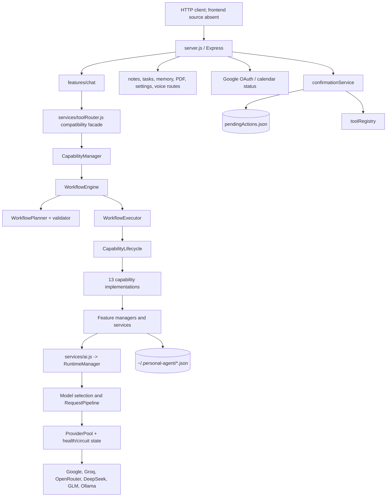
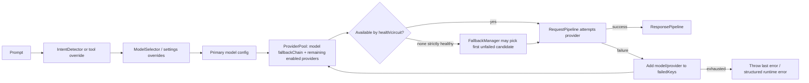

# samGPT backend architecture

This describes the checked-out source tree as audited on 2026-10-16. It includes existing uncommitted source changes. No application source changes were made.

## System components

## Runtime/provider registry and routing

`core/runtime/ProviderPool.js` registers built-in provider implementations and tracks capability metadata, health, latency, circuit state and candidate scoring. Providers are Google Gemini, Groq, DeepSeek, GLM, OpenRouter and Ollama. `core/registry/ModelRegistry.js` defines model IDs, enablement, capabilities and per-model fallback chains. `services/modelSelection/` chooses a primary model based on intent, model availability/health, scores and settings. `RuntimeManager.execute()` resolves settings, chooses a model and calls `RequestPipeline`.

The active `ProviderPool.getCandidates()` starts with the primary model, follows that model's `fallbackChain` (or `fallback`), then adds enabled registered providers absent from the chain. The rest are scored/ranked, so the candidate order depends on the chosen model and health state. This is not a fixed Gemini → Groq → Ollama chain. The Gemini registry entry specifies fallback keys `groq`, `gpt-oss`, `ollama`; GPT-OSS resolves to OpenRouter. `FallbackPolicy.js` declares Groq, Gemini, GPT-OSS, Ollama and a builder, but repository search shows it is imported only in its test file; production `ProviderPool` does not call it. `FallbackPolicy` is thus not authoritative runtime configuration.

`RequestPipeline` uses `FallbackManager` to select candidates. Non-stream calls retry each candidate up to provider `maxRetries` (default 3 in the provider adapters) and then mark it failed for the request before trying another. `RetryManager.isRetryable()` distinguishes common permanent and transient classes, but `_executeGenerate` retry behavior should be checked in detail; application/domain errors that reach `RequestPipeline` can be interpreted as model failures. Circuit state and availability are tracked. No request-level deduplication or idempotency key is evident.

Two runtime layers remain: newer `RuntimeManager`/`RequestPipeline`/`ProviderPool`, and older CIE health/retry/fallback in `services/ai.js` (`askModelCie`, direct provider map, model registry). `askAI()` currently delegates non-stream calls to `RuntimeManager`, but `askModelCie()` and `askGroqStream()` retain legacy routing. Streaming HTTP chat calls the latter, not `RuntimeManager.executeStream()`.

### Provider routing and fallback

The picture is a schematic of the newer non-stream path. The separate CIE path uses the model's `fallbackChain` in order and a separate provider health manager. `askGroqStream` also has its own retry and fallback code. All providers failing does not always become a `CapabilityResult`: `RequestPipeline` throws; `WorkflowEngine` normalizes workflow exceptions, while `chatService` catches and supplies a generic friendly fallback. The `/chat/stream` service similarly writes a friendly message if nothing was streamed, but partial-stream recovery is handled differently.

## Module boundaries and dependency inventory

| Module | Actual path | Responsibility | Depends on | Status / evidence |
|---|---|---|---|---|
| Server | `server.js` | Express routes, CORS/body parsing, port 3001, voice process message handler | Feature routes, storage, Google APIs | Implemented; API surfaces inspected |
| API feature routes | `features/{chat,memory,notes,tasks,pdf,settings,voice}/*Routes.js` | HTTP contracts and controller dispatch | Express and services | Implemented; route declaration inspection |
| Runtime facade | `services/ai.js` | `askAI` delegates to RuntimeManager; legacy CIE methods remain | RuntimeManager, providers, CIE | Mixed-generation implementation |
| RuntimeManager | `core/runtime/RuntimeManager.js` | Settings/model selection, request pipeline and response formatting | ModelRouter, runtime pipelines | Implemented |
| Provider pool | `core/runtime/ProviderPool.js` | Registry, provider metadata, availability/score/candidate list | Provider adapters, health/circuit | Implemented; fixed canonical helper unused |
| Model catalog | `core/registry/ModelRegistry.js`, `services/modelRegistry.js` | Model metadata/config and legacy exports | Environment, settings | Implemented; dual catalog facade |
| Agent runtime | `core/agent/AgentRuntime.js` | Context assembly then capability execution; optional direct plan/execute | ContextAssembly, CapabilityManager | Implemented but ordinary chat router bypasses it |
| Capability manager | `core/capabilities/CapabilityManager.js` | Registers 13 built-ins and delegates requests to WorkflowEngine | Registry, router, workflow | Implemented |
| Workflow engine | `core/workflow/` | Plan, validate, run and aggregate | Capability registry/lifecycle | Implemented; sequential v1 |
| Tool compatibility | `services/toolRouter.js`, `core/routing/ToolRouter.js` | Legacy routeRequest API delegates to CapabilityManager | Capability framework | Implemented adapter |
| Context assembly | `core/context/ContextAssembly.js` | Parallel retrieval of memory, history, summary, PDF memory | Feature stores | Implemented; called by AgentRuntime/model-router token estimate, not passed through ordinary `ToolRouter` call |
| Memory | `features/memory/` | Store registry, ranking, importance, graph/context | JSON stores, AI extraction | Partially integrated; details in memory report |
| Email | `core/email/` | Conversation, resolution, composition, policy and provider | Gmail, contacts, confirmation | Implemented; see integration report |
| Calendar | `core/calendar/` | Intent, date/time, conflict, actions, confirmations and provider | Shared Google auth, confirmation | Implemented; unit tests run |
| Persistence | `storage/`, feature `*Storage.js` | Filesystem JSON read/write | `storagePath.js` | Implemented; no database/locking layer |

## Lifecycle and cleanup

`CapabilityLifecycle.run()` initializes once per capability instance, calls analyze, plan and execute, returns normalized `CapabilityResult`, and always calls cleanup in `finally`. `WorkflowExecutor` executes sequentially and skips dependents when a prerequisite failed or was skipped. It does not implement workflow cancellation, per-node timeout, parallel branches, retry policy, or resumable workflow persistence in the inspected implementation.

Server starts with `app.listen(3001)` and initializes `voiceManager`; no configurable host/port or coordinated shutdown handler is evident. File writes are direct `writeFile` operations; there is no atomic-temp-file replacement or database transaction layer.

See [request lifecycle](SAMGPT_REQUEST_LIFECYCLE.md), [capability/workflow](SAMGPT_CAPABILITY_WORKFLOW_ARCHITECTURE.md), and [security audit](SAMGPT_SECURITY_AND_RELIABILITY_AUDIT.md).
