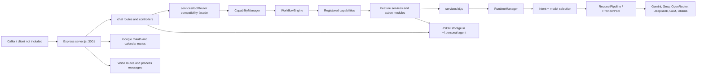

# samGPT backend overview

Audit basis: source in the checked-out working tree on 2026-10-16. Several backend files were already modified and new files already present before this audit began. This report describes that working tree; it does not imply those changes are committed. Application code and data were not changed for this audit.

## Executive summary

This is a Node.js ES-module backend with an Express API, JSON-file persistence under `~/.personal-agent/`, an AI runtime that selects among configured providers, a capability framework, a sequential workflow planner/executor, and feature modules for chat, memory, tasks, notes, PDFs, voice, email, calendar, vision, desktop, web, research and code. The repository does not contain the React frontend, Electron main/preload bridge, or renderer sources described in the brief. `main.js` is a Node readline CLI; `server.js` includes child-process message handling for voice, but this is not an Electron IPC implementation.

The capability and workflow architecture handles ordinary chat requests through `AgentRuntime`. It calls existing feature services rather than replacing them. Standard and streaming AI generation use `services/ai.js` and `RuntimeManager`; legacy `askModelCie` and `askGroqStream` entry points remain for older callers. The overlapping legacy provider paths are a remaining reliability and auditability concern.

The user-stated desired Gemini → Groq → Ollama fallback is not established as the live system-wide order. Model entries have per-model fallback chains; Gemini's registry entry lists Groq, GPT-OSS/OpenRouter and Ollama. `ProviderPool` then appends enabled providers and ranks fallback candidates. A separate `FallbackPolicy.js` describes a canonical chain but is not imported by the runtime. Ollama is implemented and registered, but availability depends on model configuration and runtime health.

Memory has seven store classes but they use a mix of in-memory state and JSON files, not separate database engines. Confirmation records are persisted, but file read/modify/write is not concurrency-safe. Email and calendar operations use confirmation policies; direct confirmation execution removes the pending record even when execution fails. The HTTP API has permissive CORS and no application authentication/authorization middleware in the inspected server, so deployment exposure needs attention before treating it as a network service.

## Runtime shape

## Main execution path

For ordinary non-streaming HTTP chat, `POST /chat` calls `handleStandardChat`, stores the user message, updates extracted memory, invokes `routeRequest`, stores the assistant answer and updates a summary. The compatibility route delegates to `AgentRuntime`, which assembles one scoped context snapshot and passes it to `CapabilityManager` and `WorkflowEngine`. The planner makes a single-node workflow for a simple request or splits recognized connector phrases into a sequential dependency chain. The executor runs each capability through `CapabilityLifecycle` and composes the terminal result.

`ContextAssembly` runs once through `AgentRuntime` for standard and streaming chat. Its snapshot is reused by model token estimation and by each provider candidate's CIE prompt fitting. `askModelCie` and other legacy callers may still assemble context through their own CIE path. See [request lifecycle](SAMGPT_REQUEST_LIFECYCLE.md).

## Current implementation assessment

- **Provider runtime:** multiple providers are implemented. Retry, circuit-breaker, health and fallback layers exist, but legacy CIE/model routing and the newer `ProviderPool` path coexist. Desired fixed ordering is not wired as one canonical policy.
- **Memory:** flat semantic profile compatibility plus specialized stores and ranking/context helpers. Actual ingestion currently calls AI extraction and writes extracted facts to semantic profile. Other stores are available but not all have active ingestion flows.
- **Capabilities/workflows:** 13 built-ins are registered. Planner is keyword/connector heuristic based; execution is sequential. Structured capability failures are recognized and block dependents.
- **Email/calendar:** Email V2 manager, Gmail provider and shared Google auth are present; calendar has five action classes and a Google provider. Confirmation paths are implemented, with persistence/concurrency and recovery gaps documented separately.
- **API/desktop:** Express routes and voice process messages exist. No React/Electron source or typed frontend contract is present in this repository.
- **Persistence:** JSON files, plain filesystem writes, and no database abstraction. Most files are located using `os.homedir()`.

## Module inventory

| Module | Actual path | Responsibility | Dependencies | Implementation status | Verification evidence |
|---|---|---|---|---|---|
| HTTP entry | `server.js` | Express initialization, route mounting, standalone endpoints, fixed port, process-message voice controls | Express, feature modules, filesystem | Implemented; CORS/auth boundaries need hardening | Routes/startup inspected |
| CLI entry | `main.js` | Readline conversational loop and command dispatch | `services/ai.js`, feature handlers | Implemented; separate from HTTP/capability entry | Source inspected |
| Chat | `features/chat/chatRoutes.js`, `chatController.js`, `chatService.js` | JSON chat, streaming response, history | `services/toolRouter.js`, storage, AI facade | Implemented with distinct standard and stream paths | Source inspected |
| Capability framework | `core/capabilities/` | Capability registry, context/result, lifecycle, routing and diagnostics | Workflow, feature services | Implemented; 13 built-ins registered | Registration in `CapabilityManager.js` |
| Workflow engine | `core/workflow/` | Heuristic planning, validation, sequential execution and aggregation | Capability lifecycle and registry | Implemented | `scratch/test_bugs_patch.js` exists; not run in this audit |
| AI runtime | `core/runtime/`, `core/registry/`, `services/ai.js`, `services/modelSelection/` | Model selection, provider registry, health, retry, fallback, response formatting | Provider modules, settings, CIE | Implemented but overlapping paths/policies | fallback regression script run; see test report |
| Providers | `services/providers/` | Gemini, Groq, Ollama, OpenRouter, DeepSeek, GLM calls | Provider SDKs and env secrets | Implemented; credentials/services required | Source inspected; no live provider calls |
| Cognitive memory | `features/memory/` | Seven store types, importance/ranking, graph, context payload, diagnostics | JSON persistence, CIE extraction | Partially integrated; semantics persist through profile; other store flows vary | Store implementations inspected |
| Tasks | `features/tasks/` | Task CRUD and planning utilities | JSON task file, AI facade | Implemented | Routes/services inspected |
| Notes | `features/notes/` | Note CRUD and search | JSON note file, AI facade | Implemented | Routes/services inspected |
| PDF | `features/pdf/` | Upload, parsing, text extraction, retrieval/search and ask | Multer, PDF/OCR packages, JSON memory | Implemented; upload boundary merits validation review | Routes/dependencies inspected |
| Voice | `features/voice/` | Audio, speech-to-text/text-to-speech, voice state and queue | Python/audio processes, AI facade | Implemented with platform dependencies | Source/routes inspected; not run |
| Email V2 | `core/email/` | Intent, contacts, draft state, confirmation, MIME/Gmail send | Google auth, generic confirmation, memory and activity storage | Implemented; recovery durability/confirmation concerns | Source inspected; not live-tested |
| Google auth/calendar | `core/google/`, `core/calendar/` | OAuth scopes/token persistence, calendar operations and policies | Google APIs, confirmation service | Implemented | calendar unit script: 89 passed |
| Desktop | `services/desktop/`, `services/tools/desktop/` | OS-level file/app/system actions and history | child processes, filesystem, platform adapters | Partially implemented/platform-dependent | Source inspected; no side-effect test |
| Confirmation | `services/confirmationService.js`, `storage/pendingActionsStorage.js` | Persist pending action and execute/cancel after confirmation | tool registry, JSON file | Cross-process state transitions use shared locks; uncertain remote outcomes are retained | Source inspected |
| Error normalization | `core/errors/` | Structured codes and safe user messages | Capability/workflow/runtime | Implemented in newer path, not universal | fallback script: normalization assertions pass |

## Documents

- [Detailed component map and diagrams](SAMGPT_BACKEND_ARCHITECTURE.md)
- [Request path](SAMGPT_REQUEST_LIFECYCLE.md)
- [Memory model](SAMGPT_MEMORY_ARCHITECTURE.md)
- [Capability and workflow execution](SAMGPT_CAPABILITY_WORKFLOW_ARCHITECTURE.md)
- [Email, Google auth and calendar](SAMGPT_EMAIL_CALENDAR_ARCHITECTURE.md)
- [API and desktop integration](SAMGPT_API_AND_ELECTRON_INTEGRATION.md)
- [Security and reliability findings](SAMGPT_SECURITY_AND_RELIABILITY_AUDIT.md)
- [Tests and verification](SAMGPT_TEST_COVERAGE.md)
