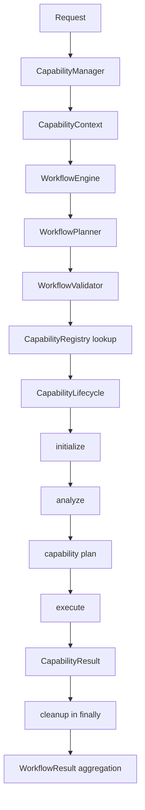
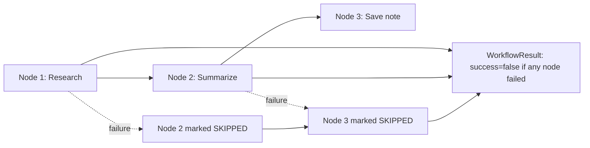

# Capability and workflow architecture

## Capability framework

`CapabilityManager` constructs `CapabilityContext`, registers built-ins with `CapabilityRegistry`, then delegates to `WorkflowEngine`. `CapabilityResult` is the common result shape. `CapabilityLifecycle` runs initialize → analyze → plan → execute → cleanup, with cleanup in `finally`. Although `CapabilityRouter` ranks capabilities through `canHandle`, the current workflow path maps prompt segments to capability names in `WorkflowPlanner` and `WorkflowExecutor` looks up those named capabilities directly. The router is therefore present but not the selector used by this execution path.

All 13 implementation classes registered in `CapabilityManager`:

| Capability class/path | Responsibility and integration | Status / boundary |
|---|---|---|
| `core/capabilities/impl/ChatCapability.js` | General dialogue via `askAI` | Registered/executable; provider tests not live-run |
| `MemoryCapability.js` | Memory retrieval/update operations | Registered; persistence through memory feature |
| `VisionCapability.js` | Image/visual analysis via vision manager | Registered; provider and file validation path exists |
| `DesktopCapability.js` | Local machine actions via desktop services/tools | Registered; side effects and OS permissions; no execution test |
| `ResearchCapability.js` | Research flow via `askAI` / research services | Registered; external search not verified |
| `CodeCapability.js` | Code assistance via `askAI` | Registered; no evidence of sandboxed code execution in this capability |
| `PDFCapability.js` | PDF search/Q&A and parsing services | Registered; upload/search APIs exist |
| `TaskCapability.js` | Task creation/management | Registered; JSON-backed task service |
| `NotesCapability.js` | Notes creation/management | Registered; JSON-backed note service |
| `WebCapability.js` | Search/web request routing | Registered; external network integration not tested |
| `VoiceCapability.js` | Voice request forwarding | Registered; platform-specific audio processes |
| `EmailCapability.js` | Email conversation facade to EmailManager | Registered; send confirmation policy |
| `CalendarCapability.js` | Calendar manager facade | Registered; five action classes and confirmation policies |

Registration means executable through the manager, not proven production complete. Tests for each capability were not systematically present or run.

### Capability contracts and effects

Each implementation receives a `CapabilityContext` from `WorkflowExecutor` containing prompt, tool context, semantic memory, history, summary, PDF memory, runtime state, preferences and outputs of earlier nodes (`workingMemory`). `CapabilityResult` provides the shared output envelope; specialized capabilities may add fields such as draft, confirmation ID, status, artifacts or metadata. Capability methods and dependent feature services define the operation-specific payloads; no single JSON schema validates all 13 inputs at the HTTP boundary.

| Capability | Input and principal output | Dependencies / side effects | Error and test evidence |
|---|---|---|---|
| Chat | Prompt/context → text answer | `askAI`, provider APIs; no direct local mutation | Provider errors throw to workflow; no capability unit test verified |
| Memory | Prompt/context → retrieved or updated memory result | MemoryManager, JSON profile and memory files; writes/deletes personal facts | Store errors may be caught by manager/normalizer; no store suite run |
| Vision | Prompt plus image/path context → analysis result | Vision pipeline, provider, image preprocessing; reads image files and may use cache | Result/error classes exist; no provider test run |
| Desktop | Prompt/context/action → operation result/artifact | DesktopManager, platform adapters/tools; may launch apps, manipulate files, clipboard, screenshot, system/power controls | Tool-specific errors; source only, no side-effect test |
| Research | Prompt → research response | Research agent/web search and AI providers; network requests/cache | Downstream errors propagate; no live research test |
| Code | Prompt → code assistance response | AI facade; no sandboxed execution established in this class | Provider errors propagate; no execution test |
| PDF | Prompt/document context → search/answer/action result | PDF services, parser/OCR, JSON PDF memory; upload/read/delete document data | Parser/service errors; no upload/security test run |
| Task | Prompt/task parameters → task result | Task service and `tasks.json`; creates/updates/deletes task data | Service/API error paths; no task suite run |
| Notes | Prompt/note parameters → note/search result | Note service and `notes.json`; CRUD writes | Service/API error paths; no notes suite run |
| Web | Prompt → search result/summary | Web search service and external network/cache | Network errors depend on adapter; not live-tested |
| Voice | Voice text/context → response/voice state | Voice manager, AI facade, audio processes/settings; microphone/speaker/process side effects | Voice errors caught at route/process boundaries; not run |
| Email | Prompt/context → EmailResult, draft, waiting status, confirmation or send status | EmailManager, contact memory, pending action file, Gmail API; sends consequential email only after policy confirmation | Structured reauth/status path exists; tests discovered but not run |
| Calendar | Prompt/context → CalendarResult, event list/availability or confirmation | CalendarManager, shared Google auth, pending action file and Calendar API; event create/update/delete | Structured auth/result errors; calendar helper tests run (89 assertions), no live provider test |

Method-level required fields vary by operation and are validated in feature policies/actions rather than by one common capability input validator. `CapabilityLifecycle` catches thrown errors only to log then rethrows; workflow executor owns node failure conversion. Returned `success:false` results are separately recognized.

## Capability path

Capability exceptions are caught by the workflow executor, which marks the node failed. A returned `CapabilityResult` with `success:false` is also marked failed. Dependents are skipped. `CapabilityManager` normalizes a missing-answer failure and has a direct chat fallback in its catch path; see source for the exact behavior. `CapabilityResult` itself defaults `success` to true, so implementations must explicitly set false on failure.

## Workflow planning and execution

`WorkflowPlanner` uses ordered regular-expression rules, not an LLM planner. Sequential connector expressions (`and then`, `then`, `after that`, `save it as`, etc.) split a prompt into segments. Each segment gets a capability rule and forms a chain where each node depends on its predecessor. It does not infer parallel branches or validate that later node text contains needed data. `WorkflowValidator` checks graph structure and registered capabilities; `WorkflowGraph.topologicalSort()` determines order.

`WorkflowExecutor` builds each node context from the original `WorkflowContext` plus prior outputs as working memory; invokes only through `CapabilityLifecycle`; records outputs; detects structured failure; and skips dependent nodes. The final workflow success is false if failed nodes exist; it includes completed, failed and skipped lists, outputs, terminal answer, executed steps, timing and diagnostics. Execution is sequential. No cancellation, timeouts, durable checkpointing, retry policy or recovery scheduler at the workflow-node level was found.

The diagram illustrates dependency handling, not a guaranteed natural-language plan. Planning may classify differently based on exact keywords. Use `WorkflowPlanner` rules as the source of truth.

## Tool registry compatibility

`services/toolRouter.js` wraps `core/routing/ToolRouter.js`; that core module delegates to `AgentRuntime`, which plans the capability graph, assembles request context, and invokes `CapabilityManager`. A separate legacy `services/toolRegistry.js` registers tool implementations used by confirmation service after approval. Thus request planning/execution and confirmed-action dispatch use distinct registries. Email/calendar capabilities may use managers directly while pending confirmations use the generic tool registry.

## Verification gaps

`scratch/test_bugs_patch.js` contains mock capability tests for workflow success propagation and appears intended to exercise dependency failure; it was not executed during this audit. `scratch/test_error_fallback_system.js` tests result contracts and fallback policy helpers, but does not prove actual workflow/provider execution. Calendar tests do verify that calendar keywords map through `WorkflowPlanner` to the calendar capability. See [test coverage](SAMGPT_TEST_COVERAGE.md).
