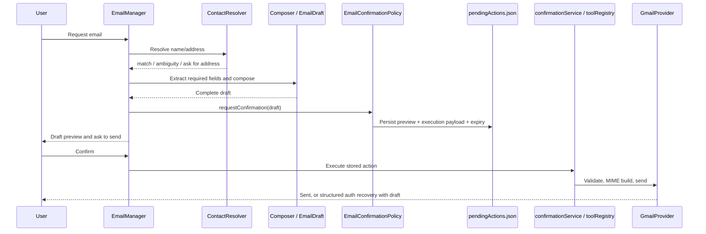
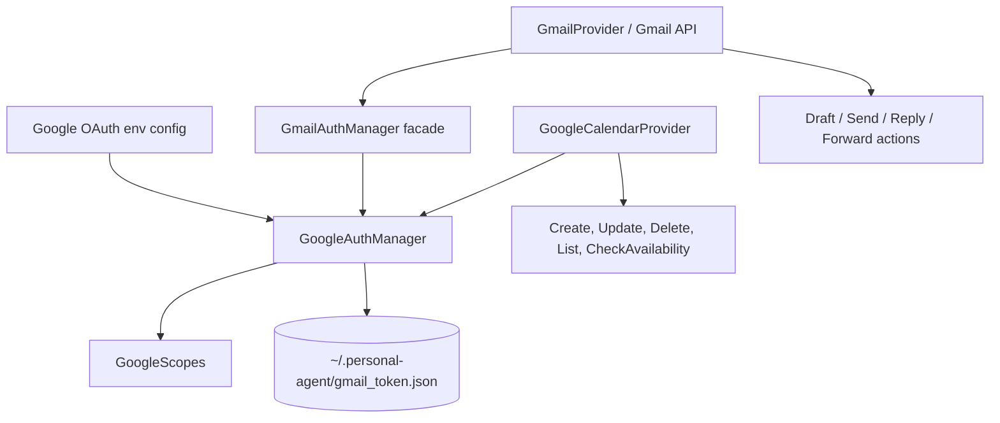

# Email, Google authentication and calendar

## Email V2 lifecycle

`EmailCapability` adapts capability context to `EmailManager.handle()`. The manager checks pending records and conversational state, resolves intent, extracts fields with `EmailIntentResolver`/`EmailFieldExtractor`, resolves contacts through `ContactResolver`/`ContactRepository`, and manages `EmailConversationState`. Missing recipients/content produce a follow-up status. `EmailComposer` combines subject/body/signature; finalized draft is retained on the in-memory conversation session. `EmailConfirmationPolicy` builds a structured `email_draft` pending record with a preview and TTL. Draft preparation does not itself send.

On confirmation, `confirmationService.confirmAction()` resolves a tool in `services/toolRegistry.js` and executes the stored action payload. `SendEmailAction` validates recipient, CC/BCC and payload before `GmailProvider.send()`. Provider builds MIME through `MimeBuilder`, authenticates through `GmailAuthManager` → shared `GoogleAuthManager`, and sends using Gmail API. On Gmail authorization failure, `GmailProvider` raises `GMAIL_REAUTH_REQUIRED`, `requiresReauth:true`, `retryable:false` and auth URL. `EmailManager.confirmSend()` maps this to `RECOVERY_REQUIRED`, disables automatic retry, and returns a preserved draft from the live session.

### Email findings

- Recipient validation is present in `SendEmailAction` and also minimally guarded in `GmailProvider`.
- Unknown contact name is stored as `pendingRecipientName`; when a valid address arrives it is associated with that name. This is source-observed, not separately tested in this audit.
- `EmailManager` keeps finalized draft/conversation state in the in-memory `EmailConversationManager`. Generic confirmation now preserves a terminal failed record and propagates an inner `success:false`; it does not make the complete draft restart-durable. Reauthorization recovery still depends on live session state, and failed actions require a newly created confirmation to retry.
- Email provider normalizes some auth failures by inspecting message text (`invalid_grant`, expired token). Reviewed Gmail send logs now omit recipient and provider error message; broader provider error normalization remains follow-up work.
- No automatic resend is performed by the described reauthorization result; user must explicitly confirm again. However, pending action is consumed on failure by generic confirmation service, and no durable draft recovery object was verified.

## Shared Google auth

`core/google/GoogleAuthManager.js` owns OAuth client construction, authorization URL construction, token exchange, credential loading and scope status. `GmailAuthManager` is a compatibility facade. `GoogleCalendarProvider` uses the shared auth manager directly. Gmail and calendar share `GMAIL_CLIENT_ID`, `GMAIL_CLIENT_SECRET`, `GMAIL_REDIRECT_URI`, and `~/.personal-agent/gmail_token.json`; business logic remains separate. `GoogleScopes.js` declares Gmail send, Calendar, and combined scopes. Token refresh event persists refreshed token fields while merging to preserve refresh token. Calendar checks that required Calendar scope exists.

The OAuth callback routes require a state value that matches a live, one-use, ten-minute entry created for that callback purpose. State is held in backend memory, so a restart invalidates the flow. Credentials and tokens are not included in this report. Google token writes are atomic and use file mode `0600`; malformed token JSON fails explicitly. `/gmail/status` and `/calendar/status` expose status but not tokens.

## Calendar actions and conversational orchestration

`CalendarManager` owns intent resolution, multi-turn session state, extraction, validation, scheduling and confirmation decisions. Provider calls are isolated in `GoogleCalendarProvider`. Action modules implement `CreateEventAction`, `UpdateEventAction`, `DeleteEventAction`, `ListEventsAction` and `CheckAvailabilityAction`. `DateTimeResolver` handles timezone interpretation; `RecurrenceResolver` maps recurrence expressions; `ConflictDetector` and `AvailabilityEngine` evaluate availability. Mutating calendar actions go through `CalendarConfirmationPolicy`; read-only listing/availability need no action confirmation. The `CalendarCapability` is registered and planner includes calendar routing rules.

Calendar manager uses generic pending confirmation persistence and handles active confirmation/cancel. Confirmation IDs expire; repeated confirmation is treated as missing/already complete by observed paths. Time zone priority in test/source is user preference → `CALENDAR_TIMEZONE` environment value → Intl runtime timezone.

## API/auth routes

`server.js` declares `/gmail/status`, `/gmail/auth`, `/gmail/callback`; `/calendar/status`, `/google/auth`, `/google/callback`. `/google/auth?service=combined|all` requests combined scopes; default uses calendar scopes. Callback failures return generic text and safe error codes are logged. These routes inherit the server's loopback and browser-origin guard, but there is no user authentication; do not expose them to network clients.

See [API integration](SAMGPT_API_AND_ELECTRON_INTEGRATION.md), [security audit](SAMGPT_SECURITY_AND_RELIABILITY_AUDIT.md), and [tests](SAMGPT_TEST_COVERAGE.md).
