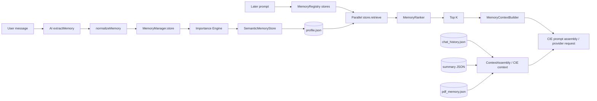

# Cognitive memory architecture

## Components and stores

`features/memory/MemoryManager.js` is the facade over `MemoryRegistry`, `MemoryImportanceEngine`, `MemoryRanker`, `MemoryContextBuilder`, `RelationshipGraph`, `ConversationCompressor` and diagnostics. Registry constructs seven stores: working, conversation, semantic, preference, project, episodic and reflection. These are logical store types, not separate databases.

| Store | Implementation | Backing store / observed use |
|---|---|---|
| Working | `features/memory/stores/WorkingMemoryStore.js` | In-memory Map; capacity-limited, not persisted |
| Conversation | `ConversationMemoryStore.js` | Existing `chat_history.json` and summary JSON; recent messages/summary |
| Semantic | `SemanticMemoryStore.js` | `profile.json`; flat key/value compatibility |
| Preference | `PreferenceMemoryStore.js` | `preferences.json` |
| Project | `ProjectMemoryStore.js` | `projects.json` |
| Episodic | `EpisodicMemoryStore.js` | `episodic.json` |
| Reflection | `ReflectionMemoryStore.js` | `reflections.json` |

`RelationshipGraph` persists graph data separately (`relationship_graph.json`); not all stores have edges and the graph does not form the retrieval ranking itself. PDF memory is separate from the seven-store registry and is held in `pdf_memory.json`.

## Ingestion and retrieval

On ordinary chat, `chatService.handleStandardChat()` invokes `updateMemory(message)` before routing. That compatibility entry leads to the memory facade, whose `MemoryManager.update()` asks `services/ai.extractMemory()` to extract facts, normalizes them and stores each as a semantic key/value item. Semantic store syncs `profile.json`. Contact resolution also has a contact repository and memory integration. This ingestion is not an explicit consent/retention workflow in the inspected code.

For `MemoryManager.retrieve(query)`, it queries every enabled store in parallel. Store implementations generally return all stored entries and ignore the query; ranking happens afterward. `MemoryRanker` ranks candidates, `topK` defaults to 10, and `MemoryContextBuilder` emits a plain key/value CIE payload with non-enumerable `_scores`. `ContextAssembly.assembleContext()` separately loads `memoryManager.retrieve`, recent history, summary and PDF memory in parallel. The CIE pipeline also has its own memory retriever, history manager, summary builder and token budget/compression path. This creates overlapping context-assembly implementations.

`RuntimeManager.execute()` passes only prompt/tool/settings to `RequestPipeline`; `runCiePipeline` inside request execution builds its prompt context for the provider. `CapabilityManager` can copy assembled memory/history/summary/PDF fields into `CapabilityContext` when supplied. The ordinary HTTP chat compatibility route does not supply the `AgentRuntime` assembled context, so do not assume that exact `ContextAssembly` object is passed to capabilities on every request.

## Ranking, importance and graph

Importance engine calculates an importance value when `MemoryManager.store()` runs; specialized stores also assign defaults. Ranking combines retrieved candidates and query-related signals in `MemoryRanker`; exact weighting and heuristic detail are in that source module and are not inferred to mean vector search. The optional embedding service exists (`services/embeddingService.js`) but there is no evidence that the seven stores persist embeddings or use a vector database. `RelationshipGraph` adds a `user has_property key` edge when a stored semantic item contains a key; relationships can also be added through legacy adapter functions. Relationship edges are not automatically used to expand ranked retrieval in the path inspected.

## Updates, deletion, privacy and diagnostics

Semantic/profile, preference/project, episodic/reflection and relationship graph mutations use shared locked JSON updates with mode `0600`; memory reads refresh the process cache from disk. Conversation history and summary use the shared JSON helper. These cooperating store operations serialize across local processes on one host, subject to the filesystem assumptions in the storage/recovery report. Compatibility full-replacement saves and direct file edits can still overwrite newer data. Working memory remains process-local. `MemoryManager.delete()` deletes from one named store (semantic by default); semantic deletion also removes the derived `user has_property` graph edge. This is not cross-store erasure: same-named preferences/projects and references in history, notes, PDFs and prior exports are not removed. `MemoryManager.consolidate()` initializes semantic storage and runs conversation compression; it is not a demonstrated cross-store deduplication transaction.

Files sit under the user's home directory in `~/.personal-agent/`; migrated JSON files use restrictive `0600` mode but are not encrypted and have no retention scheduler. `/backup` includes semantic profile data and excludes other memory stores and credentials. Logs and prompt diagnostics should be reviewed for personal content; CIE telemetry prints selected memory keys and relevance scores. Memory diagnostics exist, but do not constitute a privacy boundary.

See [storage and recovery](SAMGPT_STORAGE_AND_RECOVERY.md), [API/persistence](SAMGPT_API_AND_ELECTRON_INTEGRATION.md) and [security audit](SAMGPT_SECURITY_AND_RELIABILITY_AUDIT.md).
