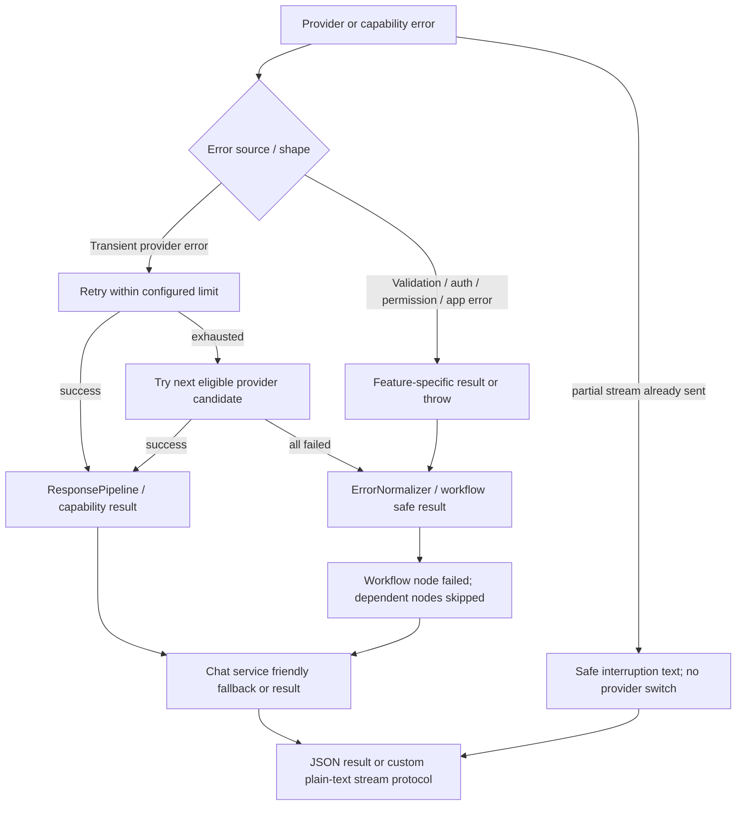

# Security and reliability audit

Scope: static source inspection of the checked-out working tree on 2026-10-16 plus local, non-network regression scripts. This is not a penetration test, dependency vulnerability scan, deployment review, or certification. No credentials or personal data were read for this report; `.env` contents were intentionally not displayed. Findings are evidence-based; baseline findings and current Phase 1 status are distinguished below.

## Phase 1 disposition (2026-10-16)

The original findings below describe the pre-hardening baseline. Phase 1 and Phase 2 changes are now present in the working tree and verified by `npm test`; implemented controls and remaining limits are summarized here.

- The API binds to `127.0.0.1:3001`; middleware also rejects non-loopback peers and unapproved browser origins. Set `SAMGPT_ALLOWED_ORIGINS` to comma-separated exact trusted HTTP(S) origins for a local browser client. This is a local single-user boundary, not authentication for network or multi-user use. `Origin: null` and Electron `file://` origins are rejected.
- Pending actions use serialized in-process JSON updates and atomic file replacement. Confirmation claims `pending → executing` before tool execution; terminal `completed` and `failed` records cannot run again. A crash after claim fails closed and requires manual reconciliation. The lock is process-local, so multiple server processes are not safe.
- Google OAuth uses unpredictable one-use state with a ten-minute expiry and callback purpose checks. State lives in memory and is invalidated by restart. Token and pending-action JSON writes are atomic and use mode `0600`; malformed files now raise a storage error instead of appearing empty. These guarantees apply to those two stores only, not all application JSON stores.
- Desktop tool dispatch validates path containment (including existing symlink targets), app names, URLs, filenames and clipboard input centrally; configured high-impact operations require confirmation. Filesystem checks still have a time-of-check/time-of-use window, and no Electron renderer/preload/bridge is present to verify the client-side confirmation contract.
- Reviewed server/controller/provider logs avoid raw error messages, prompt/body text, recipient addresses and IPC payloads. This is not an exhaustive audit of every diagnostic in the repository.

The historical findings below remain useful as a baseline record. Findings addressed by Phase 1 should be read with the disposition above; unrelated fallback, upload, API contract and data-retention findings remain open.

## Findings by severity

### High: API trust boundary is not enforced in server initialization

Before Phase 1, the API had no explicit host bind or local-access guard. It now binds to `127.0.0.1:3001`, rejects non-loopback peers and restricts browser origins. It remains unauthenticated and is intended only for a local single-user process; do not expose it on a network interface.

**Next step:** if remote or multi-user access is needed, add authenticated, authorized access and route-specific protections before changing the loopback binding. Keep bulk restore, confirmation, model test and desktop actions restricted.

### High: Consequential action confirmation is not concurrency-safe

Before Phase 1, confirmation was not claimed atomically. It now transitions `pending → executing` under an in-process file lock and atomic rename before the tool runs. Repeated/concurrent confirmations fail closed; failed and completed records remain terminal until expiry. The guarantee is process-local, and a crash after claim can leave an `executing` record needing manual reconciliation. External side effects with uncertain outcomes after a crash cannot be made exactly-once by this JSON store alone.

**Next step:** use transactional storage if multiple backend processes are introduced, and add reconciliation for claims left `executing` after a crash. Provider idempotency is still needed to resolve uncertain external side effects safely.

### High: Desktop tools can have local machine side effects through the request path

The registered `DesktopCapability` and `services/tools/desktop/*` include file deletion/movement/copy, app launch, screenshots, clipboard, power and system actions. Before Phase 1 there was no central confirmation enforcement. ToolRegistry now applies path/input validation and confirmation policy to the configured high-impact operations. The loopback boundary is not an authenticated user identity, and platform adapters still need a separate threat-model review.

**Next step:** keep the central policy aligned with every registered desktop tool and review command/platform adapters as a separate threat-model exercise. The filesystem check can race with later symlink changes.

### Medium: Sensitive errors and request content can enter logs or HTTP responses

The baseline included raw error, request, recipient and IPC logging. Phase 1 changes reviewed server/controller/provider paths to log safe error codes or message type only and returns generic OAuth/provider-facing errors. Diagnostics outside those paths remain to be reviewed; this does not assert that every repository log is sanitized.

**Next step:** audit remaining repository diagnostics and use safe error codes/metadata rather than prompt/body/address/token contents. Never return raw OAuth/provider exceptions.

### Medium: Provider fallback contract differs from the documented intended order

`FallbackPolicy.js` states Groq → Gemini → GPT-OSS/OpenRouter → Ollama, while the requested goal was Gemini primary → Groq → Ollama. The file is not used by runtime. Model registry entries contain differing fallback chains; `ProviderPool` adds enabled providers and ranks them. `askGroqStream` and legacy `askModelCie` retain their own model fallback chains, but HTTP chat streaming now uses `RequestPipeline.executeStream`. Mock regression tests cover fallback before the first chunk and prohibit switching after partial output. Production candidate ordering and live provider failures remain unverified.

**Recommendation:** consolidate to one runtime-owned fallback policy; preserve user-configured primary, define eligible failure classes, cap retry/fallback attempts, avoid retrying permanent auth/config/validation errors, and add injected-provider tests that assert the actual candidate execution order for both standard and streaming APIs.

### Medium: Email auth recovery may lose restart-safe draft state

Email draft is retained in `EmailConversationManager` memory and pending confirmation stores a send payload. Phase 1 now preserves failed confirmation records as terminal and propagates structured `success:false` results without returning provider exception details. The full draft is still not durable across restart, so reauthorization recovery can depend on live session state.

**Recommendation:** persist a recovery-required draft and terminal action state separately from executable pending confirmation; never re-send during OAuth recovery; require an explicit new confirmation after reauth. Make confirmation execution propagate inner structured result status.

### Medium: OAuth callback lacks visible state validation

Google auth URL construction previously did not validate callback state. It now creates 32-byte random state, binds it to Gmail/calendar/combined purpose, expires it after ten minutes, and consumes it once before exchanging the code. State is process memory; restarting the backend invalidates outstanding OAuth flows.

**Next step:** persist or bind state to a client session only if restart-safe OAuth is required; current state is process-local and expires after ten minutes.

### Medium: File persistence lacks atomicity, concurrency control and explicit restrictive modes

Most application JSON stores still use their existing persistence behavior. Phase 1 adds atomic replace, serialized in-process updates, explicit corruption errors and mode `0600` specifically for pending actions and Google tokens. These files are not encrypted at rest, and the helpers do not make multiple backend processes safe.

**Next step:** extend atomic writes, locking and explicit corruption reporting to remaining stores; define encryption, backup, retention and deletion behavior. Move to transactional storage before running multiple server processes.

### Low/Medium: Request input and upload bounds are not consistently visible at server boundary

`server.js` uses default `express.json()` and multer disk destination `uploads/`; PDF routes accept an uploaded file. The chat controller now rejects missing, non-string and blank chat messages, but there is no central body-size/rate limit or error mapping configured at initialization. The `/restore` route writes caller-provided collections/objects with only broad type checks. Exact impact depends on local/network exposure and downstream parsers.

**Recommendation:** apply explicit body/upload limits, MIME/signature and parser constraints; schema validate restore and all side-effect requests; clean temporary uploads on every outcome and define retention.

### Low/Medium: Legacy runtime entry points still coexist with the canonical chat lifecycle

Standard and streaming HTTP chat now pass through `AgentRuntime`, share one context snapshot, and use `RuntimeManager`/`RequestPipeline`. Legacy `askModelCie` and `askGroqStream` remain callable by older features. Other HTTP APIs also retain their distinct response shapes, and stream errors still use the marker-based text protocol rather than a universal JSON envelope.

**Recommendation:** migrate remaining direct legacy callers only after their specialized output/side-effect behavior has mocked regression coverage; preserve the current chat response contracts until client evidence supports changes.

## Error contract observed

`core/errors/ErrorCodes.js`, `ErrorNormalizer.js`, `UserErrorMessages.js` define a structured error system with code, user message, retryable/auth metadata. `CapabilityResult` and `WorkflowResult` have `success`/answer/metadata fields. Email and calendar result classes have their own statuses and metadata. Legacy provider errors use custom `type`, `code`, `status`, and message fields. HTTP controllers variously return `{error}`, `{success:false,message}`, generic `{reply}`, raw result or text markers; streaming uses `text/plain`. These contracts are not normalized consistently.

Provider retry policy does classify common transient failures vs auth/invalid request, and `RequestPipeline` tracks failed candidates in a per-request set to avoid circular attempts in that path. Non-provider errors now bubble without provider retry/health updates on this path. `FallbackPolicy` tests still do not establish production candidate order, and legacy CIE paths have separate classification behavior.

The normalization and chat boxes represent alternative boundaries, not one fully centralized handler. Direct confirmation and OAuth routes can bypass this path.

## Positive controls observed

- Gmail send action validates recipient and CC/BCC before provider invocation.
- Email and mutating calendar operations have confirmation policies.
- Pending confirmations have expiry timestamps and cleanup.
- Calendar provider uses shared OAuth scope checks and structured auth-required result handling.
- Desktop screenshot route validates filename before serving a path.
- Modern request pipeline maintains failed-key sets; streaming path avoids switching providers after yielded content.
- Error-normalizer regression assertions pass in the script executed for this audit.

## Priorities

1. Keep the API loopback-only; add authenticated authorization before any network or multi-user use.
2. Resolve `executing` confirmation records after crashes and define reconciliation for uncertain external side effects.
3. Consolidate live provider routing and establish actual failure classification/order tests.
4. Apply storage hardening consistently to remaining stores; define upload/data retention and delete/export behavior.
5. Verify a future Electron/browser client contract, especially origin and confirmation behavior.

See [test coverage](SAMGPT_TEST_COVERAGE.md) for verification limits.
