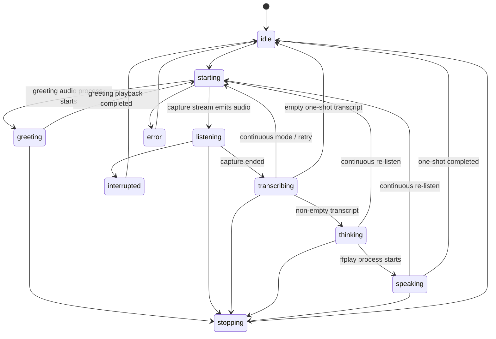

# SamGPT Voice System Design

## Session ownership

`VoiceManager` is the only session coordinator. `VoiceStateMachine` owns the public lifecycle state. One session generation and one `AbortController` invalidate capture, request, and speech work after stop or restart. React subscribes to the backend state forwarded through Electron IPC; it does not run a competing speech state machine.

## Lifecycle



The implementation defines allowed edges in `features/voice/VoiceStateMachine.js`; invalid edges are rejected. `starting` covers settings, model, recorder initialization, and TTS generation. `greeting` begins only when the greeting's actual `ffplay` child emits `spawn`; successful completion is reported after the queue drains with exit status zero. `listening` begins on the first capture-stream chunk. `speaking` begins when the response playback process starts, not while the model or TTS is still working.

## Data flow

```mermaid
sequenceDiagram
  participant UI as React VoiceExperience
  participant Preload as Electron preload
  participant Main as Electron main process
  participant Backend as Express/backend process
  participant VM as VoiceManager
  participant Audio as arecord / Whisper / ffplay / Edge TTS
  participant AI as Existing agent runtime
  UI->>Preload: startListening()
  Preload->>Main: desktop:start-listening
  Main->>Backend: START_LISTENING over child IPC
  Backend->>VM: startVoiceMode()
  VM->>Audio: generate greeting MP3
  VM->>Audio: play greeting; wait for successful drain
  VM->>Audio: capture WAV and VAD end-of-utterance
  Audio-->>VM: transcript
  VM->>AI: routeRequest(text, "voice", {signal})
  AI-->>VM: answer
  VM->>Audio: synthesize sentence batch and play in order
  Backend-->>Main: VOICE_STATE_CHANGE
  Main-->>Preload: desktop:voice-state-change
  Preload-->>UI: authoritative state + transcript/answer
```

The transcript and response go to the renderer over the existing local child-process IPC channel for display. Developer diagnostics contain only lifecycle event names, safe error codes, character counts, and timings; transcripts, replies, tokens, and audio payloads are not written to diagnostic events.

## Controls and cancellation

- Start sends the existing `START_LISTENING` IPC command, which now starts the complete greeting-first session. Duplicate requests share the same in-flight startup.
- Stop/interrupt aborts the capture signal, increments the session generation, stops queued playback, and invalidates late STT/model/TTS results. The existing runtime accepts `AbortSignal`, so the voice request passes its session signal into `routeRequest`.
- Mute microphone replaces incoming PCM samples with zeroes before writing the temporary WAV and running VAD. Capture remains visibly active until the user unmutes or stops; samples received while muted are not submitted to Whisper.
- Pause/resume controls pause/resume the `ffplay` child with process signals. A separate microphone mute control zeroes captured samples before persistence/transcription.
- Repeat-last-response sends `REPEAT_LAST_RESPONSE` through Electron IPC and reuses the last assistant response without sending a second model request. In continuous mode it interrupts the currently active listen before replay.
- Continuous listening is opt-in via `conversationMode`. Otherwise a completed answer returns to idle. No idle capture or wake-word listener is created.
- Cleanup is idempotent at the UI subscription, queue, recorder, and temporary-file boundaries. The generation check protects against asynchronous results arriving after a stop or a newer session.

## Transcript and conversation behavior

The recognized transcript is added once to chat history and shown when the manager enters `thinking`; the assistant response is added once and shown when playback begins. Empty transcripts do not call the model. The established voice runtime route is retained so context assembly, provider selection/fallback, request correlation, and cancellation continue to apply. Speech output is sanitized and preprocessed before sentence splitting.

The legacy `POST /voice` endpoint remains a separate one-shot compatibility route. It uses the old `askAI` adapter and server-side microphone flow; the main Electron screen must use the manager/IPC path.

## Visualization and accessibility

The existing canvas orb and ring waveform use lifecycle state and reduced-motion preferences. They have no analyser data source and therefore do not claim to visualize actual audio amplitude. VoiceStatus provides textual labels with a polite live region, microphone/session state is visible, controls have accessible labels, and errors render as an actionable alert. True amplitude-reactive visualization would require an audio analyser connected to actual capture/playback and is not claimed by this implementation.
